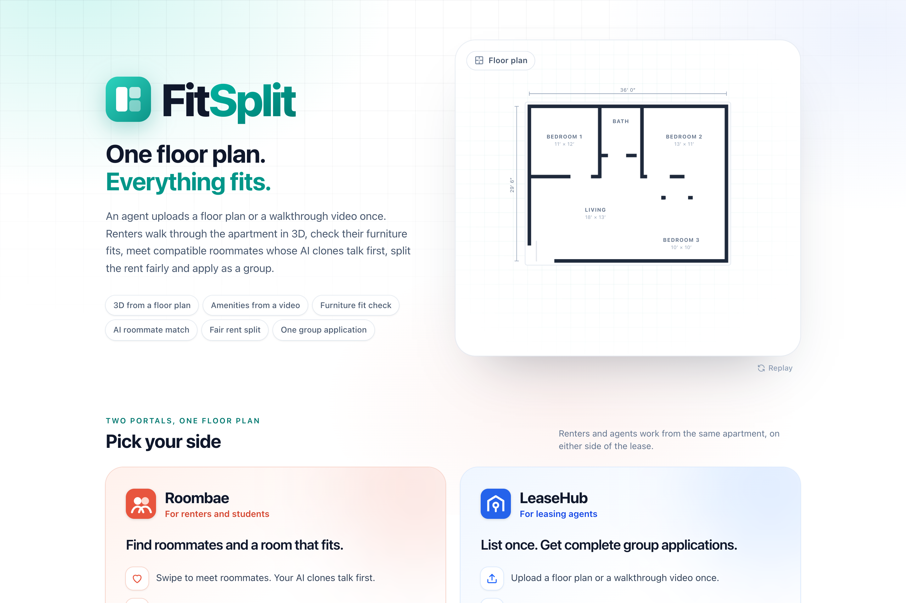
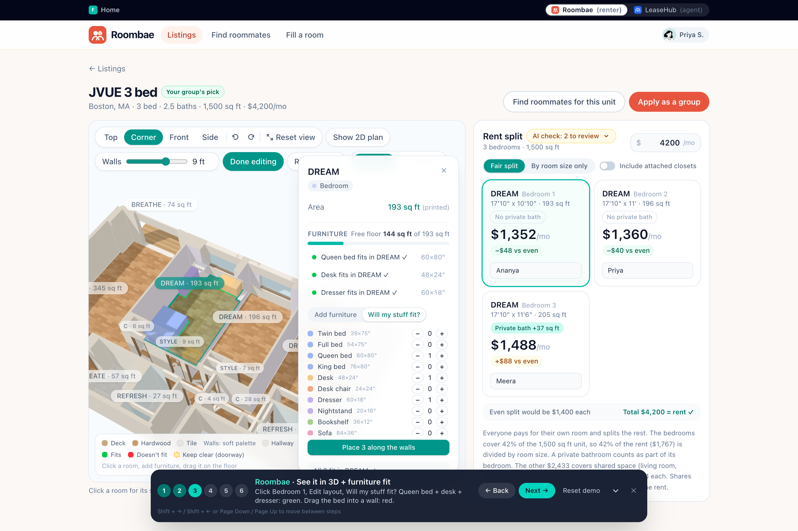
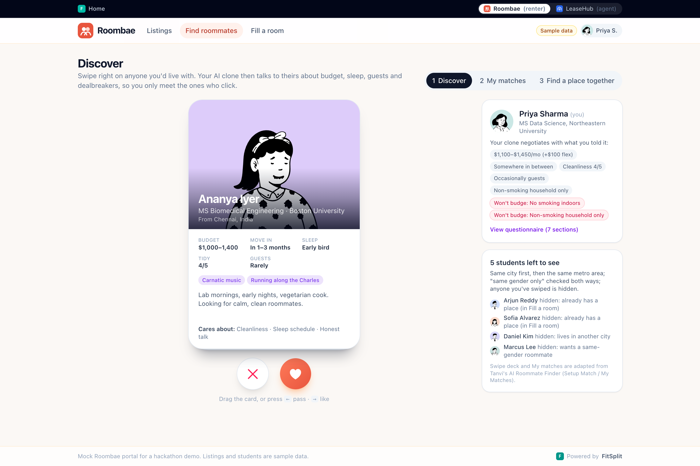
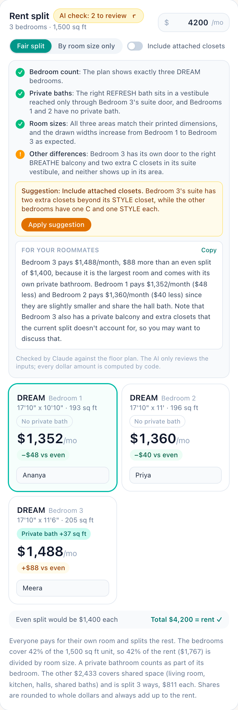
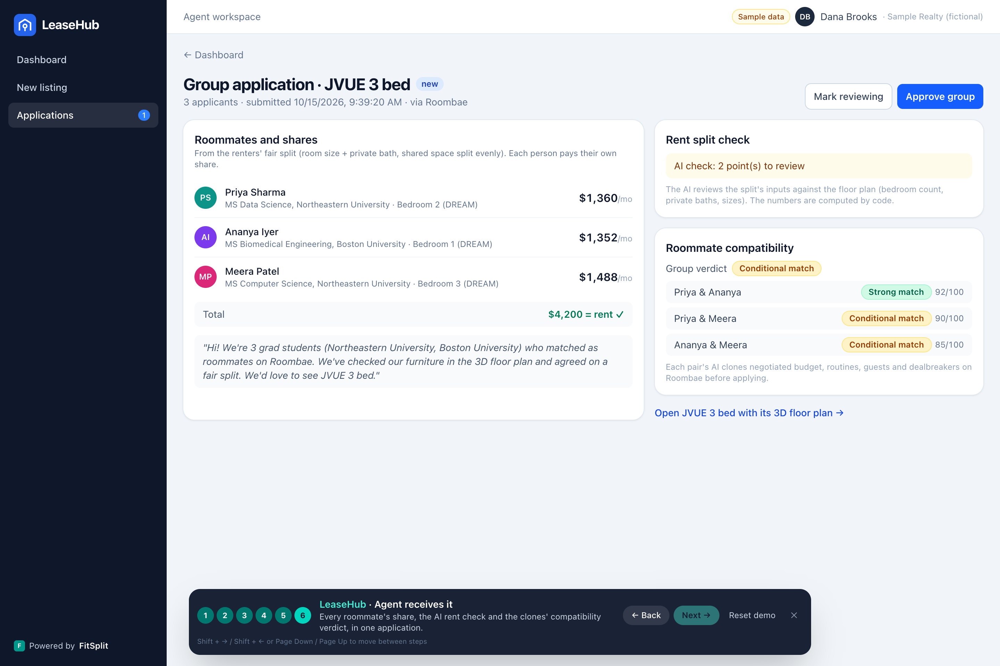
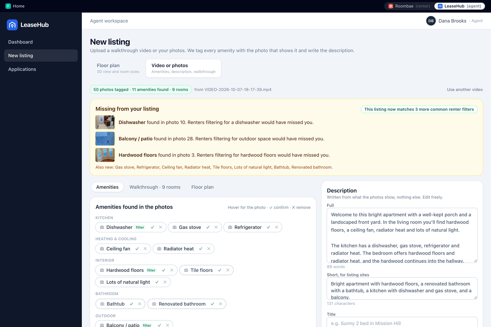
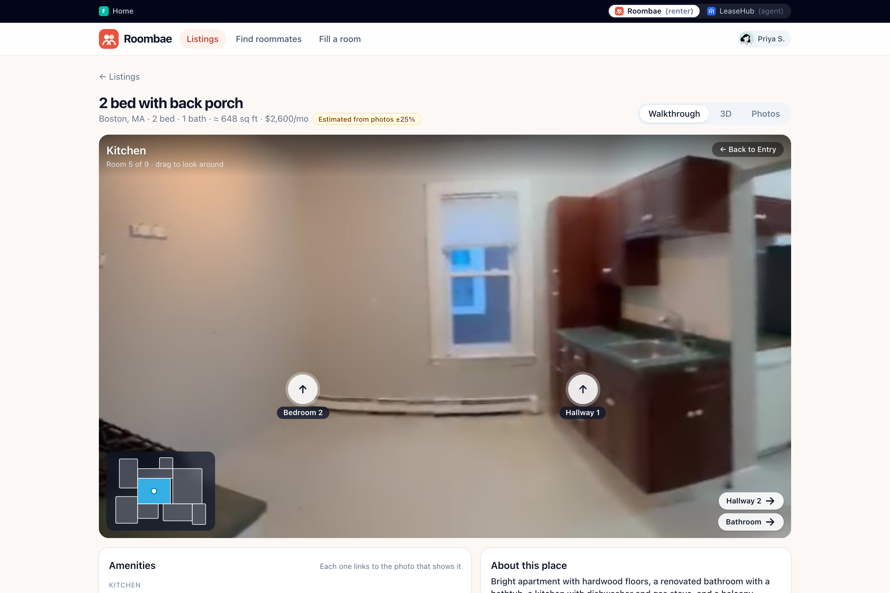
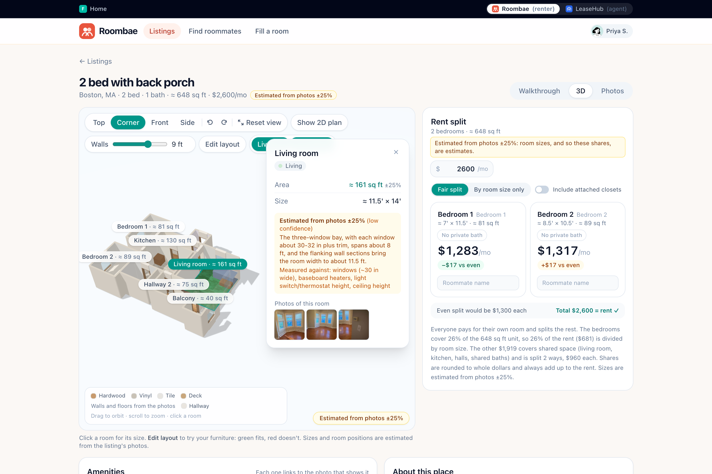
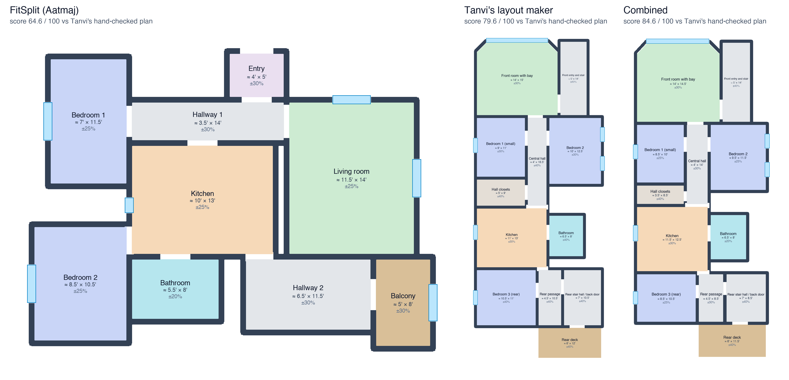

# FitSplit

**One floor plan. Everything fits.**

FitSplit turns a single apartment floor plan, or a phone walkthrough video, into everything renters
and agents need. You get a 3D model with room sizes, a check that your furniture fits, a fair rent
split that AI double-checks, and roommates matched by AI clones that talk to each other first. From a
video it also tags every amenity with the photo that shows it, writes the description, builds a
walkthrough and estimates a floor plan. It powers two portals: **LeaseHub**, where agents post
listings, and **Roombae**, where students find roommates and a place together.



## The problem

- **Agents (LeaseHub)** answer the same questions on every listing: how big is the bedroom, will my
  bed fit, who pays what. Group applications arrive incomplete or fall apart because the roommates
  never talked about guests, noise or budgets.
- **Renters (Roombae)** pick roommates from a short chat, guess at room sizes from a flat drawing,
  and argue about who pays for the bigger room.

FitSplit answers all of that from the floor plan the agent already has. The renters arrive as a
matched group with an agreed split, so the agent receives one complete application.

## Features

- **Floor plan to 3D.** Upload a floor plan image and get walls, rooms with areas, doors and windows,
  and a 3D model. It has Top / Corner / Front / Side views, a wall cutaway, touch controls and Reset
  view.
- **Listing video or photos** (LeaseHub, New listing, "Video or photos"). Upload one phone video
  (.mov / HEVC, .mp4) or several photos (.jpg, .heic), up to 500 MB:
  - **Photo tagging:** each sharp frame is tagged with its room, amenities, flooring, wall color and
    light. The listing gets an amenity checklist where every amenity links to the photos that show
    it. You confirm or remove each one.
  - **"Missing from your listing":** what the photos show that your listing text doesn't, e.g.
    "Dishwasher found in photo 10. Renters filtering for a dishwasher would have missed you."
  - **Description:** a full and a short version, written from the tags only (no invented claims or
    numbers), and editable.
  - **Walkthrough:** frames grouped into rooms; each room is a stitched panorama (or its photos)
    with arrows to the next room, a minimap, keyboard and touch.
  - **Estimated floor plan:** three layout engines, switchable on the listing (see
    [Layout engines](#layout-engines)). The default combines **Tanvi's layout maker**, which reads
    the whole video at once, with FitSplit's room-by-room sizes from doors, appliances and fixtures.
    It feeds the same 3D view, furniture fit and rent split, and every size is labelled "Estimated
    from photos ±N%".
- **Lived-in 3D.** Walls painted and floors in real materials (from the listing's photos when it has
  them), and a **Furnished** view that places furniture in every room with the fit check. Click a
  room to see its photos.
- **Furniture fit.** Place a bed, desk or dresser (or a custom size) in any room. Green means it fits
  against the real walls; red means it hits a wall or another piece. Doorways are kept clear, and
  "Will my stuff fit?" places a whole set along the walls.
- **Fair rent split with an AI check.** Each bedroom's own area (plus a private bath) is private, and
  shared space is split evenly. Shares are whole dollars that always add up to the rent. A vision
  model checks the inputs against the drawing (bedroom count, private baths, room sizes, extras like a
  private balcony) and suggests fixes. The AI never changes a number.
- **AI roommate matching.**
  - **Swipe deck:** students near you, filtered by city or metro area and by gender preference
    (checked both ways).
  - **Clone conversations:** swipe right and each student's AI clone negotiates with the other's
    about budget, sleep, guests, cleaning and dealbreakers. The result is "It's a match!" or "Your
    clones didn't click", with the reason. You can replay any conversation in plain English, with
    pause, speed and skip.
  - **My matches:** every verdict, with scores and the topics still open.
  - **Group chat:** the house rules your clones agreed on (quiet hours, guests, chores, costs), plus
    a chat for the roommates.
- **Group apply.** You only see listings where every fair-split share fits each person's budget. Each
  roommate's name and exact share is filled in, and you get a PDF summary of the application.
- **Agent view (LeaseHub).** A dashboard, a new listing flow (a floor plan: upload, parse, 3D
  preview, auto-filled details, publish; or a video, see above) and group applications next to the
  listing and its 3D plan.
- **Guided 3-minute demo** at `/demo` that walks through both portals. It works fully offline.

| 3D view and furniture fit | Swipe to match |
|---|---|
|  |  |

| Fair rent split + AI check | Agent's application view |
|---|---|
|  |  |

| Video: amenities with photo evidence | Walkthrough | Floor plan estimated from photos |
|---|---|---|
|  |  |  |

## How it works

```
floor plan image ─┬─► OpenCV: walls, rooms, doors/windows, scale ─┐
                  └─► vision model: room names, printed sizes ────┴─► plan JSON ─► 3D view, furniture fit, rent split
                                                                                         │
student profiles ──► AI clones negotiate (4 phases, shared memory) ──► verdict + scores ─┴─► swipe, matches, group, apply

phone video / photos ─► frames (2 fps, blur + duplicate filter) ─► tags (10 photos per vision call) ─► amenities, description
                                                                 ─► rooms (1 call on contact sheets) ─► panoramas, walkthrough
video ─► Tanvi's contact sheets (1 tile / s) ─► whole-apartment layout (1 call) ─┐
            FitSplit sizes for the enclosed rooms (1 call each) ─────────────────┴─► her fuse step ─► plan JSON (estimated)
```

- **Floor plan parser** (`backend/app/geometry`, `pipeline.py`). OpenCV finds walls and door and
  window gaps, then closes the rooms off. A vision model (Claude, then Gemini, then Groq; see
  `VISION_CHAIN_ORDER`) reads the room names and printed dimensions, which set the scale. Results
  are cached by image hash, so a known plan comes back instantly and never calls a model again.
- **Media pipeline** (`backend/app/media`). One background job per upload, one at a time:
  - **Frames:** about 2 per second with ffmpeg; blurry frames (Laplacian variance) and near
    duplicates (perceptual hash) are dropped, and at most 50 are kept in walk order.
  - **Tags:** 10 frames per vision call.
  - **Rooms:** one call on numbered contact sheets groups frames into rooms and finds which rooms
    connect.
  - **Panoramas:** OpenCV's Stitcher, with the photos as a fallback.
  - **Sizes:** one call per room, measured against reference objects, then checked in code.
  - **Layout:** rooms placed as rectangles over the room graph.

  Job ids and every model answer are keyed by content hash, so the same video comes back instantly
  and costs nothing the second time. A 2:20 phone video takes about 3 minutes and 16 model calls the
  first time. Endpoints: `POST /api/media/jobs`, `GET /api/media/jobs/{id}` (step, progress,
  results), `GET /api/media/jobs` and `/api/media/jobs/{id}/files/...`.
- **FastAPI backend.** It serves parsing, plans, the AI rent check, the roommate engine (REST plus a
  streamed conversation), the media jobs and an LLM layer. That layer counts every call, caps Claude
  and caches every answer on disk.
- **React + three.js frontend.** React Three Fiber renders the 3D model. Furniture fit and the rent
  split are computed in the browser. Everything the guided demo needs is bundled in
  `frontend/public/demo/`, so it runs with the backend stopped.
- **Roommate engine** (`backend/app/roommates`). It is based on **Tanvi's AI Roommate Finder**
  ([github.com/Tanvi-15/AI-Roommate-Finder](https://github.com/Tanvi-15/AI-Roommate-Finder)): her
  7-section questionnaire, her ACP clone protocol and four-phase negotiation, her compatibility
  analysis, and her Setup Match / My Matches flow. FitSplit adds:
  - a shared memory, so each clone uses what the other already said;
  - exact checks in code (budget, same-gender rules);
  - rooms and rent shares from real floor plans;
  - plain-English lines for every message;
  - the group's house rules.

## Layout engines

A floor plan from a video comes from one of three engines. Each listing has a **Layout engine**
switch (Combined, Tanvi's, FitSplit) on the results screen and the listing pages, and the plan shows
who built it.

| Engine | What it does | By |
|---|---|---|
| **Combined** (default) | Tanvi's whole-apartment layout (rooms, outlines, every door and window), with FitSplit's sizes for the enclosed rooms (bedrooms, baths, halls) fused in by her least-squares step | Tanvi Deshpande and Aatmaj Salunke |
| **Tanvi's** | [Tanvi's layout maker](https://github.com/Tanvi-15/Layout-maker) (video2floorplan), Workflow A: one model call reads time-stamped contact sheets of the whole video (one tile per second) and writes her timeline + layout.json. Sizes come from doors and windows | Tanvi Deshpande |
| **FitSplit** | Frames grouped into rooms, each room sized against reference objects in 3-4 of its photos, rooms placed by how they connect | Aatmaj Salunke |

**How they compare.** On the demo video, each engine is scored against Tanvi's hand-checked plan of
the same apartment: her `apartment1`, whose three bedrooms she measured with Depth Anything 3. The
score is 0 to 100: bedrooms 15, rooms 20, room types 10, connections 20, size error on the
measured bedrooms 20, total area 15. To reproduce it, run
`backend/.venv/bin/python backend/scripts/compare_layouts.py` (no model calls).

| engine | score | rooms (ref 12) | bedrooms (ref 3) | connections P / R | measured bedrooms, area error | total sq ft (ref 1020) |
|---|---|---|---|---|---|---|
| fitsplit | **64.6** | 9 (7 matched) | 2 | 1.0 / 0.36 | bed1 +1%, bed3 +16% | 648 (-36%) |
| tanvi | **79.6** | 12 (11 matched) | 3 | 0.78 / 0.64 | bed1 +29%, bed2 -7%, bed3 +52% | 1054 (+3%) |
| combined | **84.6** | 12 (11 matched) | 3 | 0.78 / 0.64 | bed1 +7%, bed2 -15%, bed3 +15% | 926 (-9%) |

- Tanvi's reading of the whole video finds every room. FitSplit missed the second bedroom because
  its frame selection skipped those seconds (since fixed).
- FitSplit's per-room sizes are closer on the measured bedrooms.
- The combined engine takes both, so it's the default.



- **Choose the default** with `LAYOUT_ENGINE=combined|tanvi|fitsplit` in `backend/.env`. A new job
  builds only that engine. The switch builds another on request
  (`POST /api/media/jobs/{id}/engines/{engine}`) and keeps it.
- **Model calls** for the demo video: Tanvi's step is 1 call, FitSplit's sizes 1 per enclosed room
  (6), and everything is cached by image hash.
- **Depth Anything 3 (optional, off by default).** Her Workflow C measures rooms in metres from the
  video, and the combined engine then fuses those measurements in with weight 10. It needs torch and
  about 1.5 GB of models, so it isn't in the default install. To turn it on:
  1. `backend/.venv/bin/pip install -r backend/requirements-da3.txt`
  2. clone [Depth Anything 3](https://github.com/ByteDance-Seed/Depth-Anything-3) into
     `backend/third_party/` and run
     `pip install --no-deps --ignore-requires-python -e backend/third_party/Depth-Anything-3`
  3. set `DA3_MEASURE=1`
- **The port.** Her code is ported into `backend/app/media/layout_tanvi/`, and every file credits
  her. Her repo has **no license file yet**; we're confirming with her. Plain-language notes on her
  method are in [`docs/notes/tanvi_layout_maker.md`](docs/notes/tanvi_layout_maker.md).

## Tech stack

| Layer | Tools |
|---|---|
| Backend | Python 3.11, FastAPI, Uvicorn, OpenCV (incl. Stitcher), NumPy, Pillow, pillow-heif, imageio-ffmpeg, Pydantic, pytest |
| AI | Claude Opus (vision) and Sonnet (text), Gemini Flash (vision), Groq (gpt-oss-120b / 20b, qwen3.8-27b); SDKs `anthropic`, `google-genai`, `groq` |
| Frontend | React 19, TypeScript 7, Vite 8, Tailwind CSS 4, React Router 7, three.js + React Three Fiber + drei, Framer Motion, jsPDF |
| Tests | pytest (backend), Node checks on the real TS modules, Playwright browser tests (in Google Chrome) |

## Folder structure

```
backend/
  app/              FastAPI app: parser (geometry/, semantics/, pipeline.py), rent check,
                    roommates/ (engine, memory, checks, house rules), media/ (video and photos:
                    frames, tagging, description, rooms, walkthrough, layout engines; layout_tanvi/
                    is Tanvi's layout maker), llm/ (chain, usage cap, cache)
  scripts/          parse_all.py, seed_roommates.py
  tests/            pytest suite (never calls a real model)
frontend/
  src/              pages/ (home, roombae/, leasehub/, demo/), components/FloorPlan3D/, roommates/
  public/demo/      bundled plans, rent checks, profiles, conversations, avatars, house rules,
                    media/ (the demo video's frames, tags, walkthrough and estimated plan)
  scripts/          checks, browser tests, data and screenshot scripts
data/               floor plans + meta.json, parsed plans, roommate data, LLM call log + cache
                    (media/ and media_jobs/ hold your test videos and job folders; both stay out of git)
docs/               demo script, decisions, reports, screenshots
scripts/dev-all.mjs starts the API and the web app together
```

## Setup on a new laptop

### Prerequisites

| Tool | Version | Notes |
|---|---|---|
| Git | 2.x | |
| Python | **3.11** (tested 3.11.16) | the backend's pinned packages are tested on 3.11 |
| uv | 0.5 or newer (tested 0.12) | recommended; plain `venv` + `pip` works too |
| Node.js | **22 LTS or newer** (tested 24.21) | Vite 8 needs Node 20.19+ / 22.12+ |
| npm | 10 or newer (tested 11.19) | comes with Node |
| Google Chrome | any recent | only for the browser tests |

macOS and Linux work as is. On Windows, use WSL: `dev:all` starts the API from `backend/.venv/bin`.

**Video and HEIC need nothing extra.** `imageio-ffmpeg` (in `requirements.txt`) ships its own ffmpeg
binary, which reads iPhone .mov / HEVC and tone-maps HDR clips. `pillow-heif` opens iPhone .heic
photos. A system ffmpeg (`brew install ffmpeg`) isn't needed.

### Install

```bash
git clone https://github.com/aatmaj28/FitSplit.git
cd FitSplit

# backend (Python 3.11)
cd backend
uv venv --python 3.11 .venv
VIRTUAL_ENV=.venv uv pip install -r requirements.txt -r requirements-dev.txt
#   without uv:  python3.11 -m venv .venv && .venv/bin/pip install -r requirements.txt -r requirements-dev.txt
cp .env.example .env        # then add your keys (all optional, see below)
cd ..

# frontend
cd frontend && npm install && cd ..
```

### Run

```bash
npm run dev:all             # from the repo root: API on :8000 and the web app on :5173
```

| URL | What |
|---|---|
| http://localhost:5173 | FitSplit home |
| http://localhost:5173/demo | guided 3-minute tour |
| http://localhost:5173/roombae | Roombae (renters) |
| http://localhost:5173/leasehub | LeaseHub (agents) |
| http://localhost:5173/dev | parser lab (every parsed plan, raw output) |
| http://localhost:8000/docs | API docs (FastAPI) |
| http://localhost:8000/api/llm/usage | API calls per provider, Claude calls left |

Stop with Ctrl+C. Without `backend/.venv`, `dev:all` starts only the web app, and the demo still
works from the bundled data.

## API keys

All three keys are **optional**. The guided demo, every bundled floor plan, the bundled clone
conversations, rent checks and house rules all run **without any keys**. Keys only matter for new
work: a new floor plan, a changed rent split, or a conversation between two students who haven't
talked yet.

Put them in `backend/.env` (copied from `backend/.env.example`, which ships with empty values), then
restart `npm run dev:all`.

| Key | Get it at | Used for |
|---|---|---|
| `ANTHROPIC_API_KEY` | [Anthropic Console](https://console.anthropic.com/settings/keys) | first choice for both: vision (Claude Opus: reading a new floor plan, AI rent checks) and text (Claude Sonnet: clone conversations, house rules) |
| `GEMINI_API_KEY` | [Google AI Studio](https://aistudio.google.com/app/apikey) | vision fallback; a last-resort text model |
| `GROQ_API_KEY` | [GroqCloud](https://console.groq.com/keys) | free text models for clone conversations; vision last resort |

| Feature | Needs |
|---|---|
| Uploading a new floor plan, AI check of a new split | a vision key: Anthropic or Gemini (Groq as a last resort) |
| Uploading a new video or photos (tags, rooms, sizes) | a vision key (Claude first); the description uses a text key |
| A new clone conversation, house rules for a new group | a text key: Anthropic or Groq (Gemini as a last resort) |
| Everything in the guided demo | nothing |

Settings, in `backend/.env` or the shell:

- **`CLAUDE_CALL_CAP`** (default `170`): a hard cap on the total number of Claude calls, counted in
  `data/llm/usage.json`. Once it's reached, Claude is skipped and the next provider is used.
- **`LAYOUT_ENGINE`** (default `combined`): the layout engine new video jobs use: `combined`,
  `tanvi` or `fitsplit` (see [Layout engines](#layout-engines)). **`DA3_MEASURE=1`** turns on the
  optional Depth Anything 3 measurement.
- **`VISION_CHAIN_ORDER`** (default `claude,gemini,groq`): the order of the vision providers for
  floor plan parsing, the AI rent check and listing video / photos. Use `gemini,claude,groq` to try
  Gemini's free tier first.
- **`TEXT_CHAIN_ORDER`** (default `claude,groq,gemini`): the order of the text providers. Use
  `groq,gemini,claude` to put the free Groq models first.
- Both orders in use are shown at http://localhost:8000/api/health.
- **`PROVIDER_TIMEOUT_S`** (default `30`): how long one vision provider may take before the next
  one is tried.
- Model overrides are listed in `backend/.env.example`.

Every call is logged without prompts, answers or keys in `data/llm/calls.jsonl`, and account ids
are redacted. Every answer is cached in `data/llm/cache/` and `data/parsed/`, so nothing is paid for
twice.

## Guided demo

1. `npm run dev:all`, then open http://localhost:5173/demo.
2. Click **Reset and start the demo**. A step bar follows you through both portals:
   - Next / Back, or Shift + arrows, or Page Down / Page Up;
   - minimize it to a small pill in the corner.
3. The six steps:
   1. LeaseHub: the agent posts a listing from a walkthrough video (tags, missing amenities,
      walkthrough, estimated plan); the floor plan path (JVUE 3 bed) is one click away;
   2. Roombae: swipe to match;
   3. 3D view and furniture fit;
   4. fair rent split + AI check;
   5. apply as a group;
   6. LeaseHub: the agent receives the application.

The full talk track is in [`docs/DEMO_SCRIPT.md`](docs/DEMO_SCRIPT.md). **Reset demo** restores the
starting data at any time.

## Tests

```bash
npm test                                   # from the root: backend pytest + frontend offline checks

cd backend && .venv/bin/python -m pytest -q   # backend: API, parser extras, rent check, LLM chain, roommates, media pipeline, layout engines
cd frontend && npm run check && npm run build # offline logic checks + type check + production build
```

Browser tests run against a running `npm run dev:all` and drive Google Chrome:

```bash
cd frontend
node scripts/e2e-demo.mjs        # the whole guided demo, online and with the backend blocked (refreshes docs/screenshots)
node scripts/e2e-swipe.mjs       # Discover, My matches, group (online, offline, phone)
node scripts/e2e-chat.mjs        # conversation replay: scrolling, pause, speed, skip
node scripts/e2e-stepbar.mjs     # the demo step bar on every page
node scripts/e2e-nav.mjs         # home page and portal navigation
node scripts/e2e-reset.mjs       # 3D Reset view
node scripts/e2e-viewer.mjs      # 3D drag, orbit, touch, resize
node scripts/e2e-rentcheck.mjs   # AI check badge and suggestions
node scripts/e2e-media.mjs       # video results, walkthrough, estimated plan, lived-in / furnished (laptop, phone, offline)
```

`node scripts/bundle-media.mjs [job ids]` copies a finished video job into `frontend/public/demo/media/`
for offline use.

## Troubleshooting

- **Port 5173 or 8000 already in use.** Stop the other process, e.g. `lsof -ti tcp:8000 | xargs kill`
  (same for 5173), then restart `npm run dev:all`. The web app always calls the API on :8000, so
  nothing else should be listening there. If 5173 is taken, Vite moves to the next free port and
  prints it.
- **"Uploads are unavailable right now".** The API isn't running. Check the `[api]` lines in the
  terminal and make sure `backend/.venv` exists.
- **A new upload fails with "no provider" (502).** No vision key is set, or all of them are out of
  quota. Add `ANTHROPIC_API_KEY` or `GEMINI_API_KEY` to `backend/.env` and restart.
- **Quota or rate-limit errors (429).** Each provider falls back to the next one. Groq's free models
  have per-minute and daily token limits, and Gemini's free tier has a daily quota. When Claude
  reaches `CLAUDE_CALL_CAP`, Claude is skipped. Check http://localhost:8000/api/llm/usage.
- **A new floor plan is slow.** With Claude first, a live parse takes about 10 s. If
  `VISION_CHAIN_ORDER` puts Gemini first and Gemini is overloaded, it can hang until
  `PROVIDER_TIMEOUT_S` (30 s) before the next provider answers; lower the timeout or keep Claude
  first.
- **First run: the 3D view doesn't load** ("Failed to fetch dynamically imported module"). Vite is
  still pre-bundling dependencies, so reload the page. If it keeps happening, stop the server, run
  `rm -rf frontend/node_modules/.vite` and start again.
- **Browser tests can't start Chrome.** Install Google Chrome, or run `npx playwright install
  chromium` in `frontend/` and set `PW_CHANNEL=chromium`.
- **`pip install` fails on OpenCV or NumPy.** Use Python 3.11.
- **A video upload fails with "could not read video".** The file is cut off or uses a codec the
  bundled ffmpeg can't decode. Re-export it as H.264 .mp4, or upload photos instead. A video job
  takes a few minutes; the page shows each step live, and the same file uploaded again comes back
  instantly.
- **A room in the walkthrough shows photos instead of a panorama.** Its frames didn't stitch (walking
  adds parallax). Turning slowly on the spot while filming gives panoramas.

## About the data

Everything in the app is sample data:
- The students, the agent (Dana Brooks) and the group chat messages are fictional.
- Listing facts come only from `data/floorplans/meta.json`.
- The bundled walkthrough (`frontend/public/demo/media/`) comes from a phone video of a real apartment;
  the video itself stays out of the repo. Its sizes are estimates from photos, labelled as such.
- Syndication badges, 3D view counts and the time-saved figures are illustrative.

Roombae and LeaseHub appear by name only. The portals use original styling and simple original
marks, not their logos. Avatars are DiceBear "Notionists" illustrations (artwork CC0, code MIT),
pre-generated into `frontend/public/demo/avatars/`.

More detail: [`docs/DECISIONS.md`](docs/DECISIONS.md) (every design decision),
[`docs/FIXES_2026-10-15.md`](docs/FIXES_2026-10-15.md),
[`docs/OVERNIGHT_REPORT.md`](docs/OVERNIGHT_REPORT.md) and
[`docs/notes/roommate_engine_analysis.md`](docs/notes/roommate_engine_analysis.md).

## Contributors

- **Tanvi Deshpande** ([@Tanvi-15](https://github.com/Tanvi-15)): the roommate engine
  ([AI Roommate Finder](https://github.com/Tanvi-15/AI-Roommate-Finder): questionnaire, clone
  protocol, negotiation, Setup Match / My Matches) and the
  [layout maker](https://github.com/Tanvi-15/Layout-maker) behind the Tanvi's and Combined layout
  engines.
- **Aatmaj Salunke** ([@aatmaj28](https://github.com/aatmaj28)): FitSplit itself: the floor plan
  parser, 3D view and furniture fit, rent split and AI check, both portals, the video / photo
  pipeline (tagging, walkthrough, FitSplit layout engine) and the guided demo.

---

**Built by Tanvi Deshpande and Aatmaj Salunke.** The roommate engine builds on Tanvi's
[AI Roommate Finder](https://github.com/Tanvi-15/AI-Roommate-Finder), and the default layout engine
on her [layout maker](https://github.com/Tanvi-15/Layout-maker).
